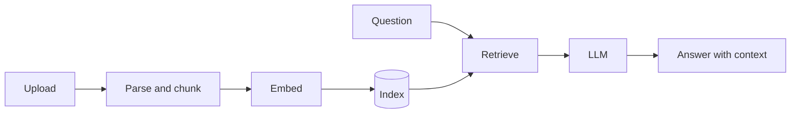

<p align="center">
  
</p>

<p align="center">
  
  
  
  
  
  
</p>

```python
from dataclasses import dataclass, field

@dataclass
class Swarup:
    name: str = "Swarup Kar Chaudhuri"
    degree: str = "B.Tech, Electrical Engineering"
    focus: list = field(default_factory=lambda: [
        "backend services",
        "retrieval-augmented generation",
        "applications built on language models",
    ])
    building: str = "AI Document Assistant"
    learning: list = field(default_factory=lambda: [
        "NumPy / Pandas",
        "machine learning and NLP",
        "testing and deployment",
    ])
```

I'm an electrical engineering student building backend services and applications on top of language models. Most of my time goes into Python, FastAPI and PostgreSQL, and into finding out how retrieval-augmented generation behaves outside of tutorials.

---

## Featured project

### [AI Document Assistant](https://github.com/swarup-infy/AI-DOC-Assistant)

A backend-first system for ingesting documents securely and answering questions over them with RAG.



| Layer | Tools |
|:--|:--|
| API | Python, FastAPI |
| Storage | PostgreSQL, SQLAlchemy |
| AI | LLM APIs, embeddings, retrieval |

---

## Stack

<table>
  <tr>
    <td><b>Languages</b></td>
    <td></td>
  </tr>
  <tr>
    <td><b>Backend and data</b></td>
    <td></td>
  </tr>
  <tr>
    <td><b>Frontend</b></td>
    <td></td>
  </tr>
  <tr>
    <td><b>Tooling</b></td>
    <td></td>
  </tr>
</table>

---

## Activity

<p align="center">
  
  
</p>


<!-- Generated by .github/workflows/snake.yml and published to the output branch. -->

---

## Contact

<p>
  <a href="https://github.com/swarup-infy"></a>
  <a href="https://www.linkedin.com/in/YOUR-HANDLE"></a>
  <a href="mailto:YOUR-EMAIL"></a>
</p>
